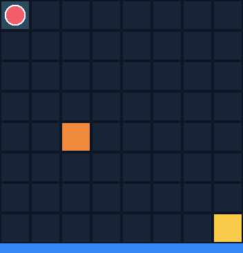

# FPGA dynamic robot path planner

This is a personal project. I got a Digilent Nexys 3 board (Spartan-6 XC6SLX16) for EE 541, Design of Digital Systems, and I wanted to build something on it that goes beyond the class labs. So I made a small path planner in Verilog.

The idea is simple. There is an 8x8 grid. A robot starts at the top-left cell (0) and has to reach the bottom-right cell (63). The FPGA finds the shortest route with breadth-first search (BFS), moving only up, down, left, or right. Then the robot follows that route one cell at a time. If an obstacle shows up on the part of the route it has not walked yet, the robot stops and the FPGA plans again from where the robot is standing.

There is no real robot or motor here. The robot is just a register on the FPGA that holds the current cell. The board sends the robot position, the obstacle map, and the route to my laptop over USB-UART, and a Python script draws the grid.

So far I have tested this in simulation. The steps for the board are further down.

## What is in the repo

- rtl/neighbor_check.v: gives the up/down/left/right neighbor of a cell and says if it is off the grid.
- rtl/bfs_engine.v: the BFS itself. It uses a queue, visited flags, and a parent table, and traces the route back from the goal.
- rtl/uart_tx.v: a simple UART transmitter, 115200 baud.
- rtl/nexys3_top.v: the top level for the board. It handles the button, the switches, the LEDs, the robot timer, replanning, and the UART packets.
- constraints/nexys3.ucf: pin constraints for the Nexys 3.
- tb/tb_bfs_engine.v: tests BFS on four fixed maps.
- tb/tb_nexys3_dynamic.v: tests the whole top level with one obstacle added while the robot moves.
- tb/tb_random_dynamic.v: a random test with walls that appear and one block that moves.
- tools/visualize.py: draws the grid, either from a simulation file or live from the board.

## Running the simulations

I use Icarus Verilog and Python 3 with Tkinter on a Mac. Outputs go into sim/, which I do not commit.

```sh
mkdir -p sim
```

BFS on fixed maps:

```sh
iverilog -g2012 -Wall -s tb_bfs_engine -o sim/bfs.out rtl/neighbor_check.v rtl/bfs_engine.v tb/tb_bfs_engine.v
vvp sim/bfs.out
python3 tools/visualize.py --sim sim/events.csv
```

This runs four cases: an empty map (14 steps), a map with two walls that forces a detour (28 steps), the same map with the gap closed (no route), and the gap opened again (28 steps). The viewer shows BFS exploring the cells and then the route.

The full top level with one new obstacle:

```sh
iverilog -g2012 -Wall -s tb_nexys3_dynamic -o sim/dynamic.out rtl/neighbor_check.v rtl/bfs_engine.v rtl/uart_tx.v rtl/nexys3_top.v tb/tb_nexys3_dynamic.v
vvp sim/dynamic.out
```

Here the robot moves faster than on the board so the test does not take forever. When the robot reaches cell 8, the test turns on SW2, which puts an obstacle at cell 32 on the route. It checks that the new route starts from cell 8 and does not go through cell 32. This test only writes a waveform (sim/dynamic.vcd) that you can open in GTKWave.

Random obstacles and a moving block:

```sh
iverilog -g2012 -Wall -s tb_random_dynamic -o sim/random.out rtl/neighbor_check.v rtl/bfs_engine.v tb/tb_random_dynamic.v
vvp sim/random.out +seed=36
python3 tools/visualize.py --replay sim/random_dynamic.csv
python3 tools/visualize.py --replay sim/random_dynamic.csv --gif sim/run.gif
python3 tools/visualize.py --replay sim/random_dynamic.csv --text
```

In this test, walls show up at random while the robot moves, and about half of them land right on its route. One block also walks back and forth along row 4. Every time something blocks the route, the real bfs_engine plans again from the robot's current cell. If only the moving block is in the way and there is no other route, the robot waits a step. I do not allow a wall that would cut off the goal for good, so every run can finish.

The test checks every route against a separate shortest-path calculation. It fails if a route is not the shortest one, goes through a wall, skips a cell, or if the robot runs into something or never gets to the goal. Different seeds give different runs. You can make it harder with +wall_rate=50 +max_walls=20.

The first viewer command plays the run in a window. The second saves it as an animated GIF, and the third prints it in the terminal.

Here are two runs from this test. The first one uses the default settings (seed 36): 20 steps, 6 replans. The second one has more walls (seed 46, +wall_rate=50 +max_walls=20): 21 steps, 11 replans, and one step where the robot has to wait for the moving block.

 

What the colors mean:

-  Red circle: the robot
-  Green: the route the robot is following
-  Purple: the old route, for one frame, right after something blocks it
-  Grey: a wall that appeared
-  Orange: the moving block that walks along row 4
-  Yellow: the goal, cell 63
-  Dark teal: cells the robot already walked through
-  Steel blue: cells BFS looked at while planning (shown only on the planning frame)

The bar at the bottom shows what is going on: green when the robot moves, blue when it plans, red when the route is blocked, and yellow when it is waiting or has reached the goal.

One thing to be clear about: in this random test, the robot and the moving block are simulated in the testbench. Only the BFS part is my hardware. On the board, the top level still supports just the one SW2 obstacle.

## Running it on the Nexys 3

I build the bitstream with Xilinx ISE 14.6 or 14.7 in an Ubuntu VM, since ISE does not run on a Mac.

1. Make an ISE project for XC6SLX16-CSG324 (use the speed grade your board shows, usually -3) and set nexys3_top as the top module.
2. Add the four files in rtl/ and constraints/nexys3.ucf. The testbenches are only for simulation.
3. Run Synthesize, Implement Design, and Generate Programming File. Check the pins in the UCF against your board revision. Program nexys3_top.bit with iMPACT or Adept.
4. Plug the UART micro-USB port (J13) into the laptop too. On a Mac, find the port with `ls /dev/cu.usb*` and install pyserial with `python3 -m pip install pyserial`.
5. Run `python3 tools/visualize.py --port /dev/cu.usbserial-XXXX` with your port name.
6. Leave all switches off and press BTNU. The robot starts at cell 0 and moves one cell every two seconds. While it is still on the left edge (cell 8 is a good time), turn SW2 on. That puts an obstacle at cell 32, and the robot should get a new route from where it is. Turning SW2 off removes the obstacle but does not change the current route.

SW0 and SW1 pick the starting map for the next run: both off is empty, SW0 on is the two-wall detour, SW1 on is the blocked map, and both on is empty again. LED0 is on while the robot moves, LED1 means a route was found, and LED2 means it is planning. After the robot reaches the goal, release BTNU and press it again to start over.

Some details: the clock is 100 MHz, the UART is 115200 baud 8N1, and the button debounce is about 10 ms. The switches on this board read low when they are on, so the code inverts them. Each update over UART is 21 bytes: A5, robot cell, found flag, route length, number of explored cells, 8 bytes of obstacle map, and 8 bytes of route map (little endian). In live mode the PC only draws what the FPGA sends. It does not compute any path itself.

Board reference manual: https://digilent.com/reference/_media/nexys%3Anexys3%3Anexys3_rm.pdf
