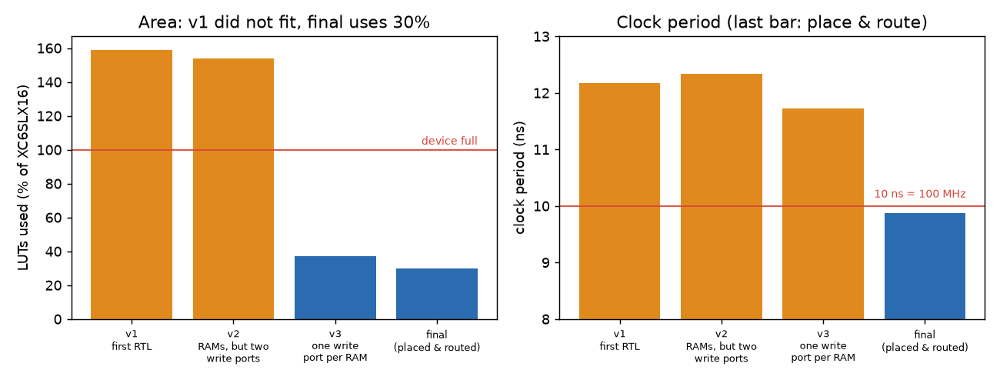
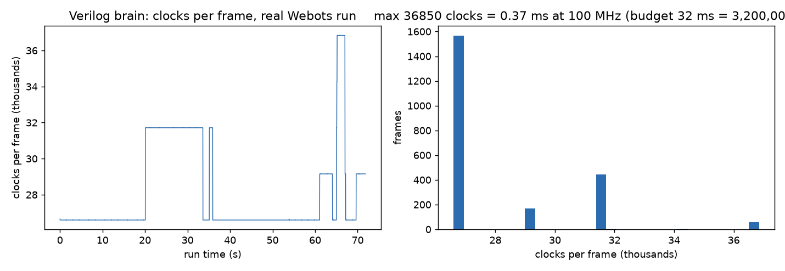
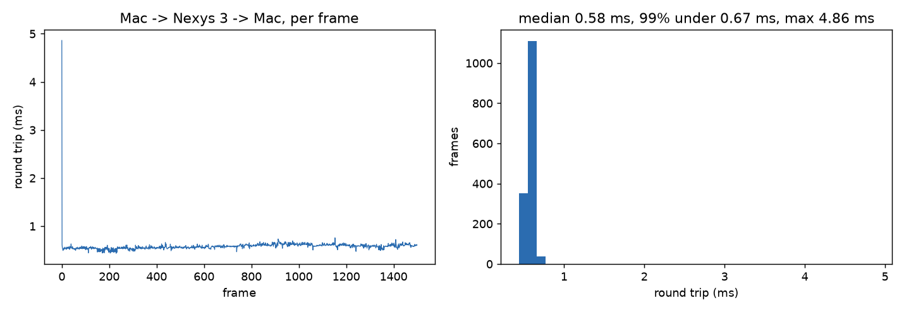
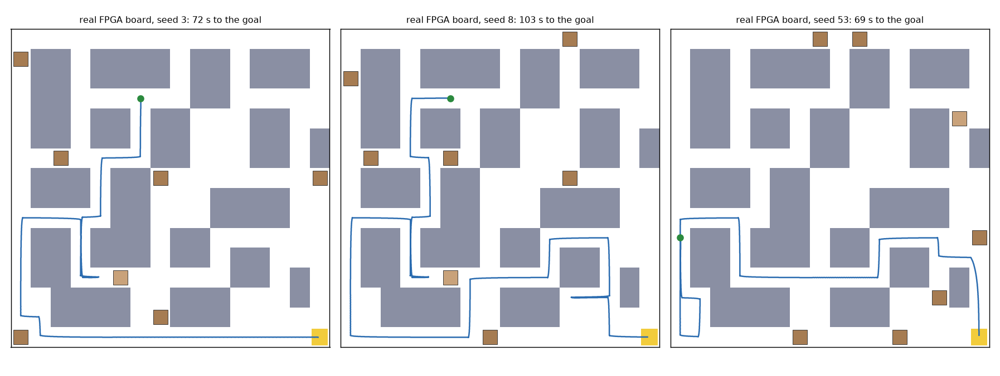
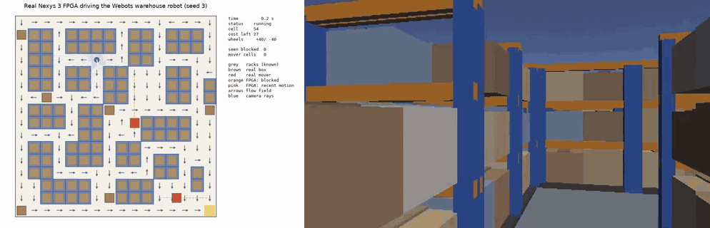
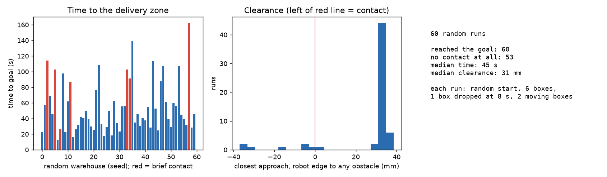

# Results: the flow-field warehouse robot on the real Nexys 3

Everything below was measured on the final design. "Board" means the real Nexys 3 (Spartan-6 XC6SLX16), programmed through ISE 14.6 in the Ubuntu VM and driven over Ethernet; "model" means the Python golden model in `ref/`. How to reproduce each line is in [flowfield.md](flowfield.md); the commands and raw logs are named next to each result.

## Summary

| | |
|---|---|
| Fits the chip? | Yes: 2,768 LUTs (30%), 3,857 registers (21%), 1,143 slices (50%), 9 RAMB8 (14%), 13 DSP48 (40%) |
| 100 MHz timing? | Met after place & route: worst slack +0.125 ns, 0 timing errors (`artifacts/ff_timing.twr`) |
| Verilog = model? | Yes, byte for byte: 5,346 frames in the brain testbench, 2,246 frames as real Ethernet frames through the whole top level, 1,500 frames on the board |
| Real board in the loop? | Webots drove its robot through the board over Ethernet from random starts to the delivery zone, no packet lost, wheel commands identical to the model (seeds 3, 8, 53; seed 43 as an extra) |
| Speed | A frame takes at most 36,850 clocks = 0.37 ms (median 0.27 ms) out of 32 ms. Round trip Mac - board - Mac: median 0.58 ms |
| Random warehouses | 60 of 60 reached the goal (median 45 s, slowest 162 s); 53 with no contact at all |

## The design in numbers

The first RTL needed **159% of the chip**: Spartan-6 distributed RAM has one write port, and arrays written at two different addresses from different FSM states became flip-flops and multiplexers (plus a dynamic part-select of a 1024-bit register that became a 2040-bit shifter). One write port per RAM, and per-cell state in RAM, brought it to 30%. Pipeline stages after the sine ROM and in the cost-field sweep took the clock period from about 12.2 ns to 9.9 ns after place & route.

| ISE 14.6, XC6SLX16-3-CSG324 | final design |
|---|---|
| Slice LUTs | 2,768 of 9,112 (30%) |
| Slice registers | 3,857 of 18,224 (21%) |
| Occupied slices | 1,143 of 2,278 (50%) |
| RAMB8 | 9 of 64 (14%) |
| DSP48A1 | 13 of 32 (40%) |
| Minimum clock period (100 MHz domain) | 9.875 ns, slack +0.125 ns |
| Bitstream | `artifacts/ff_top.bit`, sha256 `c18d5db3e658...bfbf` |

Reports: `artifacts/ff_timing.twr`, `artifacts/ff_top_map.mrp`, `artifacts/ff_top.par`. The slack is thin; see "Known limits" in [flowfield.md](flowfield.md).

## Time per frame

The brain rebuilds the whole cost field every frame. In the real Webots run of seed 3 (2,246 frames) the slowest frame took 36,850 clocks, 0.37 ms at 100 MHz, about 1% of the 32 ms between frames (`tb/tb_ff_brain.v +cycles`).

Round trip from the Mac to the board and back, per frame, for a 1,500-frame replay: median 0.58 ms, 99% under 0.67 ms, worst 4.9 ms (`bridge/replay_frames_ff.py --rtt`).

## Is the Verilog the same as the model?

| Test | Frames | Differences |
|---|---|---|
| Brain testbench (`tb_ff_brain`), five vector sets: random run, second random run, random wall clicks, goal walled in then reopened, real Webots recording | 700 + 900 + 600 + 900 + 2,246 = 5,346 | 0 |
| Whole top level over simulated Ethernet (`tb_nexys3_ff`): CRC, IPv4 checksum and UDP header of every frame checked, bad-CRC and wrong-port frames, a lost strip, a reset | 2,246 | 0 |
| **Real board**, replay of a recorded run over Ethernet (`replay_frames_ff.py`) | 1,500 | 0 (0 timeouts) |

The vectors include the awkward cases on purpose: ignored packets, a lost camera strip, wall clicks on and off the route, a reset in the middle of a run, and the goal walled in so that there is no route.

## The real board driving the robot

Webots with the real Nexys 3 in the loop (`tools/run_hw_demo.sh SEED`). The bridge only formats sensor data and applies the wheel speeds the board sends back. After each run the recording is replayed through the model: the wheel commands matched on every frame.

| Seed | Time to goal | Frames | Packets lost | Closest approach to anything | Wheel commands different from the model |
|---|---|---|---|---|---|
| 3 | 71.9 s | 2,246 | 0 | 30.7 mm | 0 |
| 8 | 103.2 s | 3,224 | 0 | 3.3 mm | 0 |
| 53 | 68.6 s | 2,144 | 0 | 1.9 mm | 0 |
| 43 (extra) | 103.8 s | 3,245 | 0 | -0.3 mm (brushed a rack corner) | 0 |

The full-length demo is on YouTube: [https://youtu.be/R98e_o1Yoh4](https://youtu.be/R98e_o1Yoh4). Per run, `tools/run_hw_demo.sh SEED` makes three videos: a top-down view (what the robot did and what the FPGA believed: racks, real boxes and carts, the cells it thinks are blocked, the flow field, the camera rays), the robot's-eye view (a plain colour camera used only for the video), and Webots' own 3D view. The video files are not kept in the repository because of their size.

## 60 random warehouses

Each run: a random start, six random boxes, one more box dropped at 8 s at least 0.8 m from the robot, and two carts patrolling their lanes at 45 mm/s. This is the Python world with ray-cast cameras (`ref/sim_world.py`), the same code the Verilog is proven equal to, so it is a good proxy for the board.

- **All 60 reached the delivery zone.** Median 45 s, slowest 162 s (long detours through dead ends are normal in a maze).
- **53 had no contact at all.** Median closest approach 31 mm (the geometric limit in a one-cell corridor is 38 mm).
- **7 touched something for a moment:** six times a cart ran over the robot's position (7 to 53 frames, i.e. 0.2 to 1.7 s; the carts do not stop for the robot) and once the robot grazed a rack corner by 3.5 mm.

## What went wrong on the way, and what fixed it

| Problem | Cause | Fix |
|---|---|---|
| Design needed 159% of the LUTs | RAMs with two write addresses became flip-flops; a 1024-bit dynamic part-select became a 2040-bit shifter | one write port per RAM, per-cell state in RAM (now 30%) |
| 12.2 ns clock period | sine ROM straight into a multiplier; three comparators in series in the cost-field sweep | pipeline stages (9.9 ns after place & route) |
| Phantom obstacles beside every rack | heading table in 1.4 degree steps: 12 mm sideways error at 1 m | 1024-entry table; ignore hits within 14 mm of a cell edge |
| Robot circled forever in the maze | memory fade forgot real boxes; then rays grazing a box's edge margin counted as "seen free" and erased a correct memory at long range | fade only on the known cart lanes (plus a no-route deadlock breaker); a ray proves a cell free only if it passes through its middle |
| Robot turned back and forth between two routes | route costs swap as carts pass | do not step back to the cell just left unless 8 cheaper |
| Cart ran into the robot head-on | halo only behind the cart | halo 3 cells wide, mover timer 2 s |
| Two runs stuck or touched a cart in one-cell corridors | cart lanes ran through one-cell corridors, where a cart is a moving wall | lanes moved to areas at least two cells wide (60 of 60 now finish) |
| Webots spun at 100% CPU and never started | `--minimize` with this setup | do not pass `--minimize` |
| 647 lost frames right after programming | the Ethernet PHY needs a few seconds to come up | `fpga/program.sh` waits 10 s |

## Honest limits

- A cart that comes round a blind corner can still touch the robot (the cameras see 1.5 m, not closer than 50 mm); a camera-based safety stop would not catch it and could stall the robot at the goal, so none was added.
- The robot can graze a rack corner in a one-cell gap by a few millimetres after resuming from an off-centre stop. Re-centring first would fix it, but it is a controller change in both model and RTL, and the timing slack is only 0.125 ns.
- The carts do not stop for the robot. Real AGVs have safety scanners; adding one to the simulation would remove most of the cart contacts above.
- Single robot. The cost field is built outward from the goal, so three robots could share it by treating each other's cells as extra cost; that is not built.
- The pose (x, y, heading) comes from the bridge (Webots GPS and compass).
- Timing was met with 0.125 ns to spare. The design is safe on this board as built, but any RTL change needs a new place & route and a timing check.
