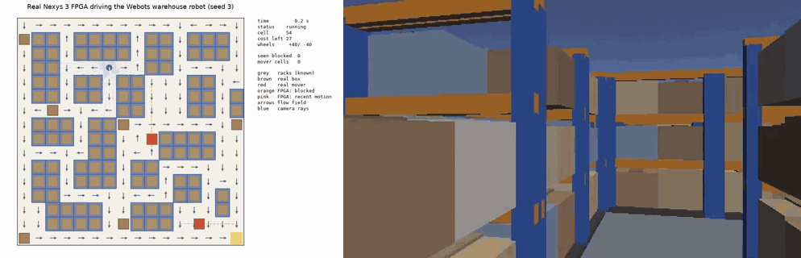
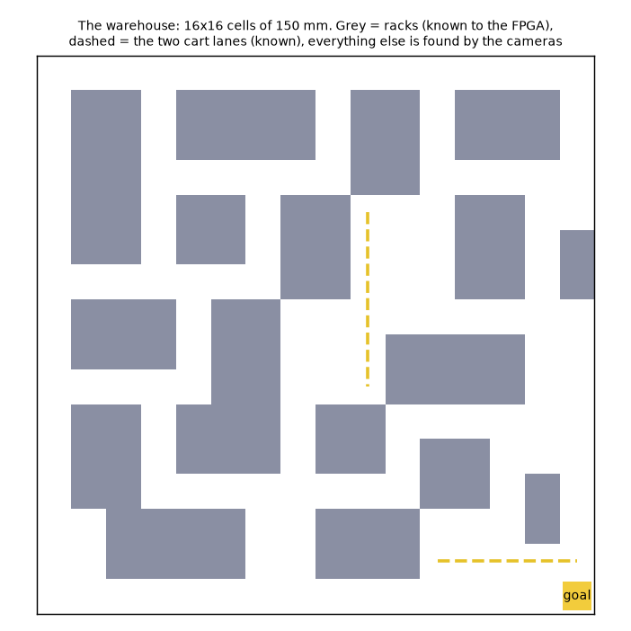

# Flow-field warehouse robot

The FPGA is the whole brain of a simulated warehouse robot. It gets the robot's pose and four small depth images from the robot's own cameras, works out what is in the way, and sends back wheel speeds. BFS (kept in `bfs/`) is replaced by a **cost field and flow field** computed on the FPGA every frame, so a new obstacle changes the robot's direction on the very next frame.

The idea comes from the PCB router in `pcb-ff3d-routing` (`compute_integration_field_3d` is a reverse Dijkstra from the goal, `compute_flow_field_3d` points every cell at its cheapest neighbour). Here it is 2D with one goal, and it is built with integers only, so the Verilog matches the Python model bit for bit.

Results, graphs and the demo video are in [RESULTS.md](RESULTS.md).



```
Webots (Mac)                  bridge (Mac)                FPGA (Nexys 3)
------------                  ------------                ---------------
e-puck + 4 depth cameras ---> 4 x C3 strips + C2 pose --> eth_ff_rx   (CRC, column ranges)
racks, boxes, carts           (UDP, docs/packets_ff.md)    ff_brain     perception -> halo -> cost field -> flow -> drive
wheels  <---------------------  B6 reply  <---------------  eth_udp_tx
```

## The world



16x16 cells of 150 mm (a 2.4 m square), cell = row * 16 + col, row 0 north. The e-puck is 74 mm wide, so even the one-cell corridors work. The layout is deliberately irregular and maze-like: tall racks along the west wall, offset rack bands, island blocks, dead-end aisles, a few wide cross aisles and an open loading area around the delivery zone (south-east corner, cell 255).

What the FPGA knows ahead of time is only what a real warehouse would hand a robot: the **racks** and the two **cart lanes** (the traffic lanes the carts patrol). Everything else is found from the cameras:

- **Boxes** (cartons on pallets): six random ones per run, plus one dropped at 8 s on a cell at least 0.8 m from the robot (the same rule runs in `ref/sim_world.py`, the Webots supervisor and the checkers).
- **Carts** (yellow, with a beacon): two moving obstacles that ping-pong along two lanes at 45 mm/s, about half the robot's speed: column 9 from row 4 to 9, and row 14 from column 11 to 15 (the open loading area). Both lanes run through areas at least two cells wide, so the robot can always pass a cart; with lanes through one-cell corridors a cart is a moving wall and the robot livelocked.

In Webots the racks are steel shelving bays (blue posts, orange beams, cartons on three levels), built by `webots/make_world.py`. They stay inside their cell, and the two lower levels are solid up to 134 mm, so the depth cameras (mounted 70 mm high) see a solid block, as the FPGA assumes.

The robot's-eye view (the right half of the picture at the top) is a plain colour camera used only for the video; the brain never sees it. Webots' own 3D view of the same run is in the demo video.

## How the FPGA decides (ref/ is the exact model, rtl/ff_brain.v the hardware)

1. **Perception** (`ref/perception.py`). Each of the 128 camera columns (4 cameras x 32) becomes a ray. The ray is sampled in 16 steps. Cells it passes through the *middle* of count as seen free; the cell it ends in counts as seen occupied. Racks are ignored, and so is any hit within 14 mm of a cell edge (that is where rack faces and the perimeter wall are). Per cell: a 2-bit occupancy count (+1 on a hit, -1 when only passed through, blocked at 2 or more) and a 6-bit mover timer, set to 63 frames when a blocked cell empties. A cell that stays blocked is a box; one that empties is a mover. Unobserved cells fade one step per 32 frames only on the known cart lanes (so the ghost of a cart that left view cannot block a lane), or anywhere while there is no route at all (a deadlock breaker). Boxes elsewhere are never forgotten while a route exists.
2. **Halo** (`flowfield.dilate`, hardware: an exact two-pass Manhattan distance transform). Distance of every cell to the nearest mover-timer cell, capped at 4.
3. **Cost field** (`ref/flowfield.py`). A cost to the goal for every cell: step cost 1, plus 10, 6 or 3 within 1, 2 or 3 cells of a mover timer; blocked cells are infinite. Built from scratch every frame by forward/backward raster sweeps until nothing changes (a reverse Dijkstra). The worst frame seen takes 36,850 clocks (0.37 ms) of the 3,200,000 available in 32 ms.
4. **Flow** (`ref/brain_ff.py`). The robot drives to the neighbouring cell with the lowest cost and picks the next one on arrival. It does not step straight back to the cell it just left unless that is cheaper by 8, which stops it dithering between two routes whose costs swap as obstacles move.
5. **Drive**: the same waypoint controller as the BFS version (`bfs/ref/brain.py`).

## What is where

| | |
|---|---|
| `ref/warehouse.py` | the map, lanes, camera geometry and every shared constant; writes `rtl/ff_tables.v` |
| `ref/perception.py`, `ref/flowfield.py`, `ref/brain_ff.py` | the golden model, integers only |
| `ref/sim_world.py` | small stand-in for Webots (racks, boxes, carts, ray-cast cameras, differential drive) for fast tests |
| `ref/test_flowfield.py` | field = Dijkstra, flow reaches the goal, perception cases, whole-robot runs |
| `rtl/eth_ff_rx.v`, `rtl/ff_brain.v`, `rtl/nexys3_top_ff.v`, `rtl/ff_tables.v` (+ `rtl/eth_udp_tx.v`) | the FPGA design. Earlier versions are in `rtl/archive/` |
| `tb/tb_ff_brain.v`, `tb/tb_nexys3_ff.v` | testbenches: brain alone, and the whole top level over real Ethernet frames |
| `ref/make_ff_vectors.py` | turns a run into test vectors (adds bad packets, a lost strip, wall clicks, a reset, a walled-in goal) |
| `bridge/mock_fpga_ff.py`, `bridge/udp_link_ff.py`, `bridge/replay_frames_ff.py` | UDP link, a mock board, and a bit-exact replay test (also logs the round trip) |
| `webots/make_world.py`, `webots/controllers/{epuck_bridge_ff,warehouse_supervisor}` | the Webots world and controllers |
| `fpga/ise.sh`, `fpga/build_ff.sh`, `fpga/program.sh` | build with ISE in a VM, program the board |
| `tools/run_hw_demo.sh` | one command: Webots driving the real board, plus all the videos |
| `tools/ff_viewer.py`, `ref/render_video.py`, `ref/make_results.py`, `ref/check_ff_run.py` | live viewer, top-down video, graphs, ground-truth check of a run |
| `bfs/` | the full BFS version, kept as a backup (self-contained, has its own README) |

## Test it in simulation (no board)

```sh
python3 ref/warehouse.py                     # regenerate rtl/ff_tables.v (only needed if the layout changes)
python3 ref/test_flowfield.py --runs 5       # unit tests + 5 random warehouse runs
```

Brain in Verilog against the Python model (Icarus Verilog):

```sh
mkdir -p sim
python3 ref/make_ff_vectors.py --seed 3 --frames 700 -o sim/ff_vectors.txt
iverilog -g2012 -Wall -s tb_ff_brain -o sim/ff_brain.out rtl/ff_tables.v rtl/ff_brain.v tb/tb_ff_brain.v
vvp sim/ff_brain.out                         # add +cycles=sim/cycles.csv for clocks per frame
# whole top level, as real Ethernet frames (CRC, IPv4 checksum and UDP header of every frame are checked):
iverilog -g2012 -Wall -s tb_nexys3_ff -o sim/ff_top.out rtl/ff_tables.v rtl/eth_udp_tx.v rtl/eth_ff_rx.v rtl/ff_brain.v rtl/nexys3_top_ff.v tb/tb_nexys3_ff.v
vvp sim/ff_top.out
```

Other vector sets: `--stress` (random wall clicks), `--cage` (the goal walled in, then opened, to test the no-route case), `--from-run sim/<recording>.npz --frames N` (a recorded Webots run).

With Webots (use a current nightly build on macOS 27: the stable release has a known start-up bug there). **Do not pass `--minimize`** to Webots: in this setup it made Webots spin at 100% CPU without starting.

```sh
python3 webots/make_world.py --seed 3                       # writes webots/worlds/warehouse.wbt
python3 bridge/mock_fpga_ff.py --quiet --reply-to 127.0.0.1 &   # a mock board on this Mac
HIL_BRAIN=udp HIL_TARGET=127.0.0.1 /Applications/Webots.app/Contents/MacOS/webots webots/worlds/warehouse.wbt
python3 tools/ff_viewer.py --target 127.0.0.1               # in another terminal
python3 ref/check_ff_run.py sim/ff_webots_udp.npz --seed 3  # after a run: clearance, false obstacles, replay
```

`HIL_BRAIN=ref` runs the Python model inside the controller instead (no UDP). A different `--seed` gives a different start, boxes and cart phases.

## Build the bitstream and run it on the real board

The ISE (Xilinx 14.6) build runs in the Ubuntu VM. The scripts expect an Ubuntu VM with ISE reachable over SSH; edit the `SSH`/`SCP` lines at the top of `fpga/ise.sh` and `fpga/program.sh` to match your VM.

```sh
fpga/ise.sh synth      # synthesis only (about 4 minutes)
fpga/ise.sh all        # + translate, map, place & route, timing report, bitstream (about 15 minutes) -> artifacts/ff_*
fpga/program.sh artifacts/ff_top.bit      # volatile JTAG load; prints PROGRAM_OK
python3 ref/record_world_run.py --seed 3 --frames 1500 -o sim/ff3_pyworld.npz      # a recording to replay
python3 bridge/replay_frames_ff.py sim/ff3_pyworld.npz --target 192.168.10.255 --rtt sim/hw_rtt.csv   # every reply must match
tools/run_hw_demo.sh 3                    # Webots driving the board, plus the videos
```

By hand in ISE instead: new project XC6SLX16-CSG324, top module `nexys3_top_ff`, add `rtl/ff_tables.v`, `rtl/eth_udp_tx.v`, `rtl/eth_ff_rx.v`, `rtl/ff_brain.v`, `rtl/nexys3_top_ff.v` and `constraints/nexys3_ff.ucf`; Generate Programming File > FPGA Start-Up Clock = JTAG Clock, Unused IOB Pins = Float (the PHY strap pins).

LEDs: LD1-0 status (00 waiting for a frame, 01 running, 10 no route, 11 at goal), LD2 on while the cost field is being rebuilt, LD3 flips per reply sent, LD4 PHY out of reset, LD5 flips per packet received, LD6 blinks with the clock.

The final design uses 2,768 LUTs (30%), 3,857 registers (21%), 13 DSP48 (40%) and 9 RAMB8 (14%), and meets 100 MHz (worst slack +0.125 ns, 0 timing errors). That margin is thin. If a future change breaks timing, the critical paths are the cost-field write path (`S_SW2`) and the ray casting (`S_SMP_*`); there are about 3,160,000 spare clocks per frame, so adding pipeline stages is free.

## Lessons from the build

- **A Spartan-6 distributed RAM has one write port.** The first version needed 159% of the chip's LUTs. Arrays written at two different addresses from different FSM states were silently built from flip-flops and multiplexers, and a dynamic part-select of a 1024-bit register became a 2040-bit shifter. Giving every RAM exactly one write port (combinational write-enable/address/data blocks) and keeping per-cell state in RAM brought it to 29%.
- **The heading table needs fine steps.** With 256 steps (1.4 degrees) the sideways error at 1 m is about 12 mm, enough to put phantom obstacles next to every rack. It is 1024 steps now (0.35 degrees).
- **Ignore hits near cell edges.** Rack faces and the perimeter wall sit exactly on cell edges; boxes are inset 20 mm.
- **Free evidence must come from the middle of a cell.** A ray grazing the 20 mm margin around an inset box used to count as "seen free" and erased a correct memory of the box at long range, so the robot kept re-discovering a phantom exit and looped for minutes in the maze.
- **Do not fade memory during normal driving.** An always-on fade made the robot forget boxes and loop. Fading only on the known cart lanes, plus a deadlock breaker when there is no route, fixes ghost carts without that.
- **Hysteresis in the flow.** Without the "do not step back unless 8 cheaper" rule, two nearly equal routes whose costs swap as carts pass made the robot turn back and forth forever.
- **Wide mover halo.** A cart's danger zone is ahead of it, not behind it, so the halo is 3 cells wide.

## Known limits

- **Blind corners are real.** The cameras see 1.5 m and not closer than 50 mm. A cart that comes round a corner into a one-cell corridor can touch the robot. In 60 random runs, 7 had a brief contact (6 with a cart); see RESULTS.md. A camera-based safety stop would not have caught them (the cart is inside the minimum range) and could stall the robot against the perimeter wall at the goal, so none was added.
- **Off-centre restarts clip corners.** If the robot stops between cells (no route) and then resumes, it steers back to the lane centre diagonally and can graze a rack corner in a one-cell corridor (a few millimetres). Fixing it means re-centring before moving, which is a controller change in both the model and the RTL.
- **Single robot.** The cost field is built outward from the goal, so 3 robots could share it by adding the other robots' cells as extra cost. That is not built.
- Pose (x, y, heading) comes from the bridge (Webots GPS and compass), like wheel odometry on a real robot; the FPGA does not localise itself.
